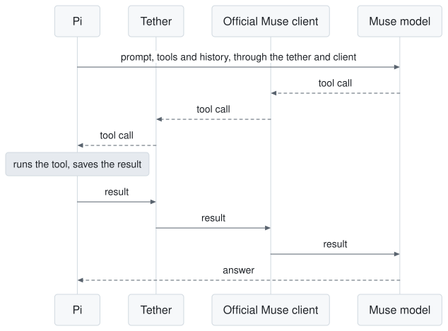

# pi-muse-tether


Use your Muse Code subscription in [Pi](https://github.com/earendil-works/pi), through the official Muse client.

Hi, I do most of my work in Pi and I also pay for Muse Code. While Meta has not been magnanimous enough to let us use our subscription directly in third-party harnesses, it still offers an [official SDK](https://github.com/meta-models/muse-code-sdk) for building clients around its installed coding agent. Pi is my main harness and I don't want to be swapping coding agents, and most importantly I don't want to juggle identities and system prompts. The goal of this tether is to unlock the high limits a subscription allows while using your own Pi custom prompt as much as possible, staying lighter on the system prompt than the less-than-optimal vendor harnesses, and not having to go through the API. I wrote it with a coding agent.

<picture>
  <source media="(prefers-color-scheme: dark)" srcset="https://raw.githubusercontent.com/kyraneth/pi-muse-tether/main/assets/flow-dark.svg">
  
</picture>

## Who it's for

This is for you if you've built your workflow around Pi, with your own system prompt, skills, extensions and subagents, and you have a Muse subscription. Muse becomes one more entry in `/model`. You can switch to it in the middle of a session and switch back later, and Pi keeps the whole conversation.

## Install

Sign in with the official Muse Code client first. You need Node 24 or newer. I tested this with Pi 1.5.0 and Muse Code 1.4.14, and other versions may be refused.

```sh
pi install npm:pi-muse-tether
PI_MUSE_TETHER_LIVE=1 pi --provider pi-muse-tether --model muse-spark-1.3
```

Keep `PI_MUSE_TETHER_LIVE=1` set whenever you want to use Muse. Without it you only get an offline test model. If it worked, the Muse models your account can use appear under `pi-muse-tether` in `/model`, and `/muse-doctor` shows the local versions it found.

## How it works

The tether starts the official Muse client in the background and passes it Pi's system prompt, tools and history. When the model asks for a tool, the call comes back to Pi, as the diagram shows. Pi runs it under its normal guards and saves the result to its own history, and only then does the tether send the result back to Muse.

## How close it is to the direct API

I ran two real coding tasks through each route, once per route, on a build from just before this release. These are single runs, so read them as a rough comparison. [How I measured](https://github.com/kyraneth/pi-muse-tether/blob/main/docs/DETAILS.md#how-i-measured).

| | Tether | Direct API |
|---|---|---|
| Input read from cache, whole run | 89.8% | 92.2% |
| Input read from cache, turns 2 to 5 | 84, 92, 98, 99% | 84, 98, 98, 100% |
| Tools run by Pi | 261 | 257 |
| Input read from cache, first turn after a resume | 0 of 230k | 222k of 226k |

The last row is the difference you will notice most.

## Why not something else

| Option | Why I didn't use it |
|---|---|
| Pi with the direct API | It works well and I used it as my baseline, but you pay per token. |
| Packages that reuse your Muse login to call the API themselves | The login belongs to the official client, and I don't want my account depending on a route Muse didn't provide. |
| Wrappers where Muse runs the tools | I want Pi's guards, hooks and tools to apply, which is the reason I use Pi. |
| [pi-muse-subscription](https://github.com/jkeskikangas/pi-muse-subscription) | This is the closest project and I learned how to replace the system prompt from it. I built my own so that it shares one tested core with my Claude tether. |

## When not to use it

- You restart Pi often in long sessions. A restart starts a new Muse client, so the next turn begins with a cold cache and processes the whole history again.
- You need control over retries. Muse retries some server errors by itself, and I found no way to turn that off.
- Your tool results must reach the model unchanged. Muse sometimes replaces secret-looking text with `[REDACTED]`, so I can't tell exactly what the model saw.
- Tool images continue without killing the turn, with declared-lossy evidence rather than a pixel guarantee. PNG/JPEG worked in small live probes; GIF/WebP were accepted but not visibly rendered in one multi-image probe. The official client's error-result path drops images. See [details](https://github.com/kyraneth/pi-muse-tether/blob/main/docs/DETAILS.md).
- Your tools run for a very long time. I tested one that ran for 5 minutes, and I don't know how much longer one can run.
- You're on a datacenter network with IPv6. On some of these, Muse returned an empty model list while the same account worked over IPv4. The tether stops and tells you when this happens.

## More

This is an independent project, and neither Muse nor Meta made it. The technical details are in [docs/DETAILS.md](https://github.com/kyraneth/pi-muse-tether/blob/main/docs/DETAILS.md). Please report problems in the [issues](https://github.com/kyraneth/pi-muse-tether/issues). [MIT license](https://github.com/kyraneth/pi-muse-tether/blob/main/LICENSE).
