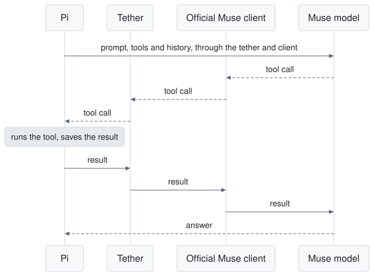

# pi-muse-tether


Use your Muse Code subscription in [Pi](https://github.com/earendil-works/pi), through the official Muse client.

Hi, I do most of my work in Pi and I also pay for Muse Code. While Meta has not been magnanimous enough to let us use our subscription directly in third-party harnesses, it still offers an [official SDK](https://github.com/meta-models/muse-code-sdk) for building clients around its installed coding agent. Pi is my main harness and I don't want to be swapping coding agents, and most importantly I don't want to juggle identities and system prompts. The goal of this tether is to unlock the high limits a subscription allows while using your own Pi custom prompt as much as possible, staying lighter on the system prompt than the less-than-optimal vendor harnesses, and not having to go through the API. I wrote it with a coding agent.

<picture>
  <source media="(prefers-color-scheme: dark)" srcset="assets/flow-dark.svg">
  
</picture>

## Who it's for

This is for you if you've built your workflow around Pi, with your own system prompt, skills, extensions and subagents, and you have a Muse subscription. Muse becomes one more entry in `/model`. You can switch to it in the middle of a session and switch back later, and Pi keeps the whole conversation. Pi's hooks keep working.

## Install

Sign in with the official Muse Code client first. You need Node 24 or newer. Tested with Pi 1.5.0 and 1.6.0; see the client version policy below.

```sh
pi install npm:pi-muse-tether
PI_MUSE_TETHER_LIVE=1 pi --provider pi-muse-tether --model muse-spark-1.3
```

Keep `PI_MUSE_TETHER_LIVE=1` set whenever you want to use Muse. Without it only the offline test model appears; `/muse-doctor` reports that live discovery is disabled. If it worked, the Muse models your account can use appear under `pi-muse-tether` in `/model`, and `/muse-doctor` shows the local versions it found.

### Optional native web search

Set `PI_MUSE_TETHER_NATIVE_SEARCH=1` alongside `PI_MUSE_TETHER_LIVE=1` to let Muse Code search the web during a Pi chat. It is off by default. Pi shows a once-per-session notice, then each native query and the source titles and URLs the client reports. Those are unverified search hits, not Pi tool calls. The opt-in neither changes Pi's tool permissions nor gives Muse a native page fetcher or image generator. Aborting in Pi cancels the native turn and retires its host; it cannot recall a remote request already sent.

The client recipe was exercised on Muse Code 1.4.25 with Ember. `PI_MUSE_TETHER_STRICT=1` refuses the opt-in before a prompt. Auxiliary summaries do not search. If a conversation requires staged history replay, unset the search flag before starting Pi; the tether refuses to submit replay stages with native search available.

## Muse Code version policy

The minimum client is **1.4.14**, the oldest version qualified for the tether’s private-XDG prompt/isolation recipe. The tested ceiling is **1.4.25**. Older or unparseable clients are refused. Newer clients continue without a startup warning. The request ledger records that the version is **not yet qualified**, including private-settings prompt delivery. Set `PI_MUSE_TETHER_STRICT_VERSION=1` to refuse clients above the tested ceiling instead. `/muse-doctor` reports the range and whether the installed client exceeds it. Meta’s official launcher owns updates; production leaves its default update behaviour enabled. Tests, proofs and qualification disable updates in isolated homes.

The SDK remains independently pinned to **`@muse-code/sdk` 1.4.14**; it need not equal the client version. Unknown builds run **sequential Pi tools** rather than refusing a turn. The ledger and `/muse-doctor` report this route choice. Parallel tools require qualification evidence matching the executable and schema, a granted `rawLog` capability, and runtime validation of each committed batch. The package includes evidence for exact builds of 1.4.14, 1.4.15 and 1.4.25; other executables are not qualified by version alone. `/muse-doctor qualify [build]` writes offline results; explicit `--live` plus confirmation runs the live suite. Only complete qualification enables parallel tools. No code change or client store is needed. Missing private replacement uses appended developer instructions; the ledger and `/muse-doctor` report this fallback. Missing session MCP still refuses with the build and cause because Pi must own tools. See [client lifecycle](docs/CLIENT-LIFECYCLE.md) and [qualification](docs/CLIENT-QUALIFICATION.md).

Muse 1.4.15 changed two things the tether now handles. It starts session tool servers after `session/start` returns, so the tether waits (via `mcpServer/readInventory`) until its tool server is connected with every Pi tool before the first turn; a withheld or failed server stops before any model request. It also starts session tool servers only in a trusted workspace. The tether names an empty, private, tether-owned workspace and trusts only that one; it never trusts your project, because a trusted project also loads its rules files (for example `AGENTS.md`) into the model. Pi still owns the working directory and every tool path.

## Models in the picker

With live mode enabled, the tether reads the official client’s `model/list`. Every valid Muse catalogue row appears with its own context/output limits and supported thinking levels; there is no model allowlist. New client models do not need a tether code change. At startup the picker uses a disposable snapshot for the same client and login, or discovers the catalogue before initial model selection if none is usable. Agent runs do not refresh the catalogue. `/muse-doctor refresh` explicitly refreshes Pi's registered list, including changed limits or removed models. If discovery is unavailable but the last same-login list is usable, `/muse-doctor` reports that it is stale; the host still checks the live catalogue before admitting a request. Discovery failure is shown on screen if no live models remain. The offline `echo` model remains available.

Each catalogue `<id>` offers its normal route (contributor mode off). Only models with verified contributor support also offer `<id>-contributor` (Contributor, mode on): currently Spark 1.3, Spark 1.2, Wonder 1.0 and Wonder Full 1.0. **Ember 1.0 has only a Normal route**: the client ignores contributor mode for Ember and the API has no Ember contributor model. Future models appear normally without a tether update; contributor routes require verifying the client's on/off wire model and the contributor model's API support, then adding the native ID to the documented `VERIFIED_CONTRIBUTOR_MODEL_IDS` constant in `src/model-route.ts`. For backward compatibility, **`muse-spark-1.3` stays contributor-on**, labelled **Contributor (legacy alias)**; `muse-spark-1.3-contributor` is the explicit Contributor choice for the same native model and mode. Existing Wonder names and modes are unchanged. Contributor suffixes select CLI recipes, not native catalogue IDs. The `-contributor` suffix is reserved for these local routes: a native catalogue row using it is skipped with a named `/muse-doctor` diagnostic, without hiding other models.

Only thinking levels present in that model’s catalogue are offered; unsupported levels are refused before submission (for example, Spark 1.2 `max`). Assistant messages report `responseModel` from the selected recipe: the native ID for Normal, or `<id>-contributor` for Contributor. Its source is marked derived, not response-attested; catalogue availability alone does not prove physical response identity or contributor support.

API reference pricing and input-limit metadata come from the exact recipe in the running Pi’s built-in Meta catalogue. Unknown prices remain `null`, labelled **pricing unknown**. Known rates are applied per reported request, including input tiers, before summing. These are API estimates, not what a Muse subscription charged.

## How it works

The tether starts the official Muse client in the background and passes it Pi's system prompt, tools and history. When the model asks for a tool, the call comes back to Pi, as the diagram shows. Pi runs it under its normal guards and saves the result to its own history, and only then does the tether send the result back to Muse.

The official client has a 10 MiB (10,485,760 byte) inbound message limit, separate from the model's token window. If a cold replay or recognized Pi summary does not fit, the tether can send its historical data in acknowledged stages on one temporary session, then present the current request once. Each stage is a model turn and cannot use Pi tools. The tether announces replay once the first stage actually starts. If the current request or an indivisible attachment does not fit, nothing is submitted and the error reports the measured size; it does not trigger model-window recovery.

## How close it is to the direct API

I ran two real coding tasks through each route, once per route, on a build from just before this release. These are single runs, so read them as a rough comparison. [How I measured](docs/DETAILS.md#how-i-measured).

| | Tether | Direct API |
|---|---|---|
| Input read from cache, whole run | 89.8% | 92.2% |
| Input read from cache, turns 2 to 5 | 84, 92, 98, 99% | 84, 98, 98, 100% |
| Tools run by Pi | 261 | 257 |
| Input read from cache, first turn after a resume | 0 of 230k | 222k of 226k |

The last row is the difference you will notice most.

## The request ledger

Every turn appends metadata-only rows to `~/.local/state/pi-muse-tether/requests.jsonl` (or `$XDG_STATE_HOME`): timing, token counts, retries, refusals and lifecycle events. No prompt, tool body, image bytes or credential is written. Since 0.2.1 each row also carries `origin` (`live`, `test` or `proof`) and the package version, and tests and proofs run in an isolated state directory.

Read it with `/muse-doctor ledger`. It counts live rows only, splits them by event type and requested model, and reports how many rows it excluded and why. Rows written before 0.2.1 have no `origin`, so they are reported as `unknown` rather than guessed at. Counting with `grep` over the raw file mixes fixture rows, legacy rows and passing mentions of an error string; this has produced wrong failure analyses before.

## Why not something else

| Option | Why I didn't use it |
|---|---|
| Pi with the direct API | It works well and I used it as my baseline, but you pay per token. |
| Packages that reuse your Muse login to call the API themselves | The login belongs to the official client, and I don't want my account depending on a route Muse didn't provide. |
| Wrappers where Muse runs the tools | I want Pi's guards, hooks and tools to apply, which is the reason I use Pi. |
| [pi-muse-subscription](https://github.com/jkeskikangas/pi-muse-subscription) | This is the closest project and I learned how to replace the system prompt from it. I built my own so that it shares one tested core with my Claude tether. |

## When not to use it

- You restart Pi often in long sessions. A restart starts a new Muse client, so the next turn begins with a cold cache and processes the whole history again.
- You need control over retries. Muse retries some server errors by itself, and I found no way to turn that off.
- Your tool results must reach the model unchanged. Muse sometimes replaces secret-looking text with `[REDACTED]`, even in harmless prose. Declared loss continues with source/position evidence in the ledger, including uncertain alignments; it does not prove the model saw the original. Literal markers may already be source text.
- You need the model to see every image your tools return. Images no longer kill the turn, but I can't prove what the model saw. It read PNG and JPEG correctly in small tests, but with six images at once it got the last JPEG wrong and said it couldn't see the GIF and WebP. Images attached to a tool error never reach it, because the official client drops them. See [details](docs/DETAILS.md).
- Your tools run for a very long time. I tested one that ran for 5 minutes, and I don't know how much longer one can run.
- You're on a datacenter network with IPv6. On some of these, Muse returned an empty model list while the same account worked over IPv4. The tether stops and tells you when this happens.

## More

This is an independent project, and neither Muse nor Meta made it. The technical details are in [docs/DETAILS.md](docs/DETAILS.md). Please report problems in the [issues](https://github.com/kyraneth/pi-muse-tether/issues). [MIT license](LICENSE).
